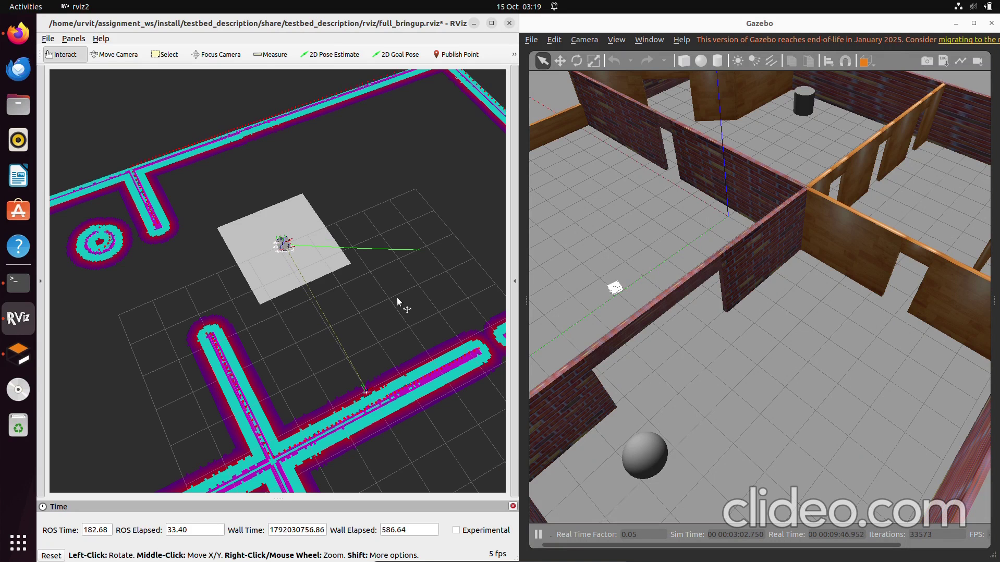
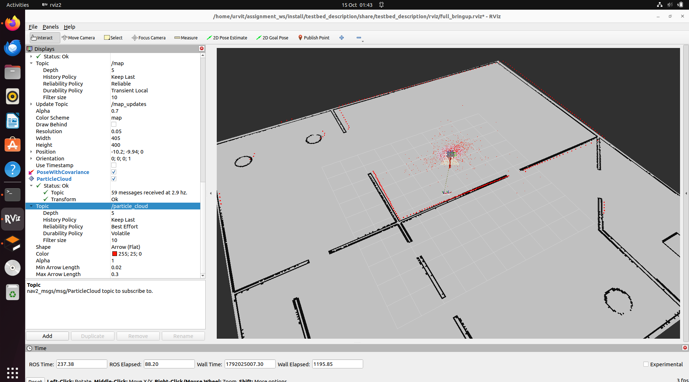
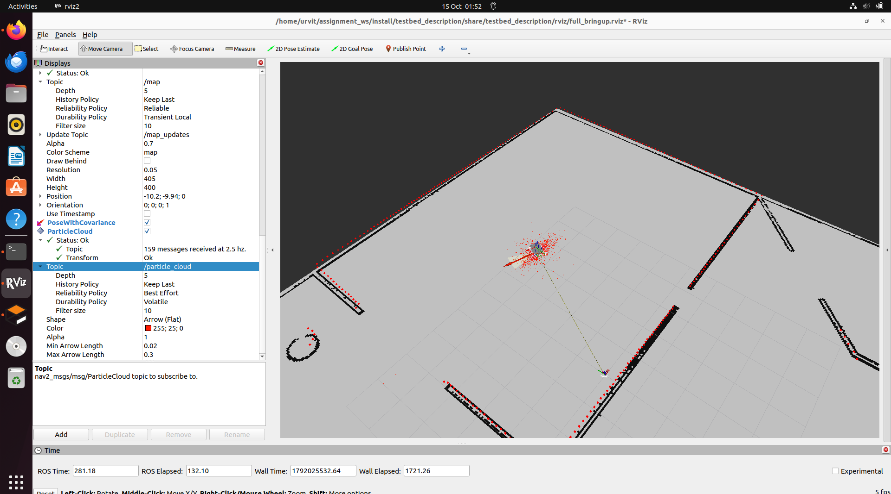

# testbed_navigation — Level 1 ROS 2 Navigation Assignment (Urvit Mathur)

`testbed_navigation` brings up Nav2 for the **Testbed-T1.0.0** robot **without `nav2_bringup`**.
Each stage of the navigation workflow — map loading, localization, navigation — is its own
launch file with its own parameter file and its own lifecycle manager, so each layer can be
started, tested and replaced independently.

▶️ **Demo video:** [`docs/path-navigation.mp4`](docs/path-navigation.mp4) (also attached to the Pull Request).
The simulation ran at ~0.3–0.5× real time in my VM (see *Challenges*).

---

## Package layout

~~~
testbed_navigation/
├── config/
│   ├── map_server_params.yaml   # map_server frame / topic
│   ├── amcl_params.yaml         # AMCL: frames, motion & laser models, initial pose
│   └── nav2_params.yaml         # planner, controller, costmaps, behaviors, BT navigator, smoother
├── launch/
│   ├── map_loader.launch.py     # map_server + lifecycle_manager_map
│   ├── localization.launch.py   # amcl + lifecycle_manager_localization
│   └── navigation.launch.py     # Nav2 servers + lifecycle_manager_navigation
├── scripts/
│   └── send_goal.py             # NavigateToPose action client (send goals from the terminal)
└── docs/                        # screenshots + demo video
~~~

## How to run

Prerequisites: ROS 2 Humble, Gazebo 11, `ros-humble-navigation2`.

~~~bash
cd ~/assignment_ws && colcon build --symlink-install && source install/setup.bash
~~~

Start each layer in its own terminal, in order (wait for `Managed nodes are active` before the next):

~~~bash
# 1. Simulation (headless Gazebo + RViz)
ros2 launch testbed_bringup testbed_full_bringup.launch.py gui:=false
# 2. Map
ros2 launch testbed_navigation map_loader.launch.py
# 3. Localization
ros2 launch testbed_navigation localization.launch.py
# 4. Navigation
ros2 launch testbed_navigation navigation.launch.py
~~~

Send a goal either with **2D Goal Pose** in RViz (Fixed Frame `map`), or by calling the
`NavigateToPose` action directly:

~~~bash
ros2 run testbed_navigation send_goal.py <x> <y> [yaw_rad]
~~~

Every file path and option is a launch argument with a default, e.g.
`ros2 launch testbed_navigation map_loader.launch.py map:=/path/to/other_map.yaml`.

---

## Architecture

~~~
map_server ──► /map ──► AMCL ◄── /scan, odom → base_footprint (Gazebo diff-drive)
                 │        └──► map → odom (TF), /amcl_pose, /particle_cloud
                 ▼
          global_costmap ──► planner_server (NavFn) ──► /plan
                                                         │
 bt_navigator (NavigateToPose behavior tree) ────────────┤
                                                         ▼
          local_costmap ──► controller_server (RPP) ──► /cmd_vel_nav
                                                         │
                             velocity_smoother ◄─────────┘
                                     └──► /cmd_vel ──► Gazebo diff-drive
 behavior_server: spin / backup / wait (recoveries triggered by the BT)
~~~

**TF tree:** `map → odom` (AMCL) → `base_footprint` (Gazebo diff-drive) → `base_link` → sensors (robot_state_publisher).

---

## Design decisions

### 1. Map loading
- `nav2_map_server` with its own lifecycle manager.
- The map path is a launch argument resolved from the `testbed_bringup` package share, and the
  map YAML uses a **relative** image path, so nothing depends on one machine's file layout.
- **Alignment check:** before adding AMCL I published a temporary identity `map → odom`
  transform. The Gazebo diff-drive plugin reports odometry in the world frame, and the live scan
  landed exactly on the map walls, which shows the map origin matches the Gazebo world. That's why
  AMCL's initial pose is simply the spawn pose.

### 2. Localization (AMCL)
| Parameter | Value | Why |
|---|---|---|
| `robot_model_type` | `DifferentialMotionModel` | Testbed is diff-drive (no lateral motion) |
| `base_frame_id` / `odom_frame_id` | `base_footprint` / `odom` | Frames published by the Gazebo diff-drive plugin |
| `laser_max_range` | 12.0 m | Matches the corrected lidar range |
| `initial_pose` | (0.0, 5.0, 0.0) | Spawn pose from `spawn_testbed.launch.py`, verified against the map |
| `max_beams` | 60 | Enough for scan matching, cheaper on CPU |
| `transform_tolerance` | 1.0 s | The simulation runs well below real time in my VM |

Verified by driving with teleop: the particle cloud converges and the scan stays on the map walls.

| Before driving | After driving |
|---|---|
|  |  |

### 3. Navigation
Only basic navigation was required, so I picked the simplest reliable plugin for each role:

| Role | Plugin | Why |
|---|---|---|
| Global planner | `nav2_navfn_planner/NavfnPlanner` | Simple, robust grid planner |
| Controller | `RegulatedPurePursuitController` | Suits a slow diff-drive robot; far fewer parameters than DWB |
| Recoveries | `Spin`, `BackUp`, `Wait` | Exactly the actions used by Nav2's default BT |
| Behavior tree | `navigate_to_pose_w_replanning_and_recovery.xml` | Default replanning + recovery tree |
| Smoothing | `nav2_velocity_smoother` | Limits acceleration: controller → `cmd_vel_nav` → smoother → `cmd_vel` |

**Costmaps:** global = static + obstacle + inflation layers (`map` frame); local = 3 × 3 m rolling
window with obstacle + inflation layers (`odom` frame).
**Robot size:** `robot_radius: 0.25 m`. From the URDF the casters span ≈ 0.25 × 0.29 m and the wheel
separation is 0.35 m. Inflation radius 0.55 m keeps paths centred in corridors.

---

## Challenges

1. **gzserver segfault (exit −11) right after spawning the robot.** I bisected: reverting my lidar
   change didn't help, so the code wasn't the cause. Switching the RMW from Cyclone DDS back to
   Fast DDS fixed it.
2. **VM graphics.** `gzclient` froze (`svga_surface_destroy` errors). Gazebo runs headless
   (`gui:=false`) with `SVGA_VGPU10=0` set, and everything is visualised in RViz.
3. **Lifecycle bond timeouts.** With the VM short on CPU, the lifecycle managers missed their 4 s
   heartbeats and shut down `map_server` and AMCL mid-navigation. The `map` frame disappeared and
   the planner lost the robot ~0.28 m from the goal. Fixed with `bond_timeout: 10.0` on all three
   lifecycle managers, and by reducing load (headless Gazebo, no browser inside the VM).
4. **Behavior tree tick rate exceeded.** Raised `bt_loop_duration` from 10 ms to 50 ms (20 Hz),
   which is plenty for a 0.3 m/s robot.
5. **"Frame map does not exist" in RViz.** A frame only exists once something publishes a TF for it.
   `map_server` publishes the map but not a transform; AMCL provides `map → odom`.
6. **Empty particle cloud display.** AMCL publishes `/particle_cloud` with best-effort QoS, so the
   RViz display has to use Best Effort reliability to receive it.

Timeouts and tolerances are deliberately generous because of the slow simulation. On a native
machine they can be tightened.

## Starter-code bugs

All bugs found in the starter code, and how they were fixed, are in
[`../BUGS_FIXED.md`](../BUGS_FIXED.md).

## Possible improvements
- Replace `robot_radius` with a footprint polygon: `base_footprint` sits ~5 cm off the wheel-axle
  centre, so a polygon would model the robot more precisely.
- Add `collision_monitor` as a safety layer between the smoother and the robot.
- Add a top-level launch file that includes all three layers for one-command startup.
- Re-tune speeds and tolerances on a machine that runs the simulation in real time.
